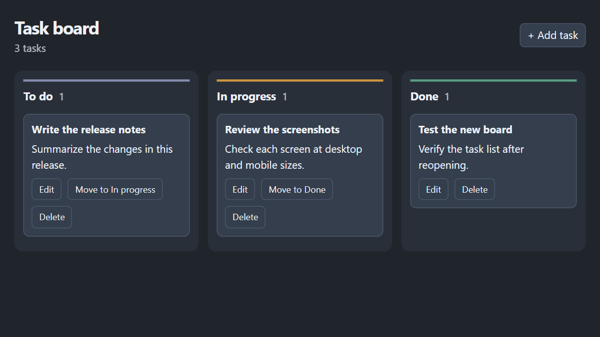
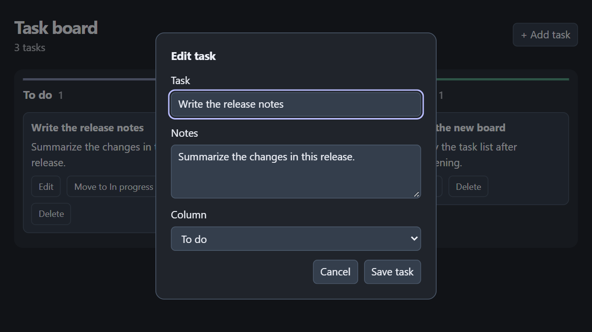

# Kanban for Nextbrowser

A standalone reference for Nextbrowser Mini Apps v2. The UI and the six WebMCP tools work on the same board. Ask the agent to create a task, change its notes, move it into Done or list completed work. Tasks persist across desktop restarts.

## Install




The [catalog listing](catalog/listing.json) credits the author and includes screenshots, workflows, requirements and an example agent request. To publish your own fork, choose a new ID, build the package and open **Mini Apps → Publish mini app** in Nextbrowser.

In a Nextbrowser desktop build with Mini Apps v2, open **Extensions → Mini Apps** and select **Install** on the Kanban card. To import a downloaded package, select **Install from file**, review the six agent actions and grant storage access. [Download Kanban 2.0.0](https://github.com/0nliner/kanban-mini-app/releases/download/v2.0.0/kanban.nbmini.json)

## Build your own mini app

Clone or fork this repository and change the ID and name in `manifest.json` for your app. Edit `index.html`, `board.css` and `board.js`, then run the following command with Node.js 22. The build uses only Node's standard library.

```sh
npm run build
```

Import the resulting `<id>.nbmini.json` in Nextbrowser. For each new capability, declare its tool in the manifest and register it on the document. The standard includes an importable counter example, the handler contract, the Kanban coverage table and the v1 upgrade procedure. [Mini Apps v2 standard](docs/mini-apps-v2.md) · [Archived v1 standard](docs/mini-apps-v1.md)

Licensed under [AGPL-3.0-only](LICENSE), as in the upstream Nextbrowser project.
